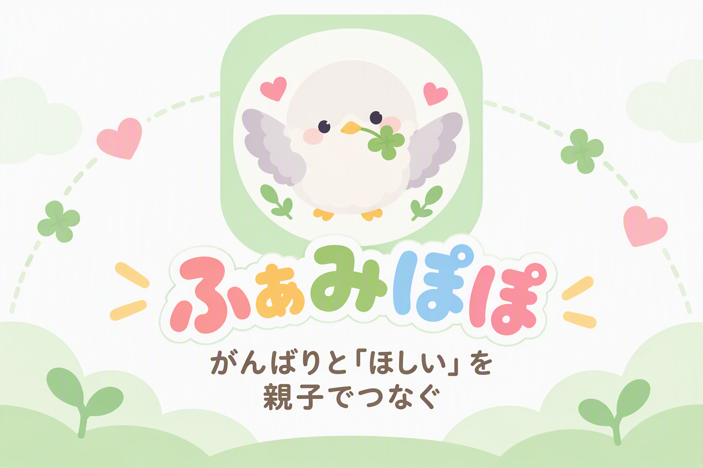
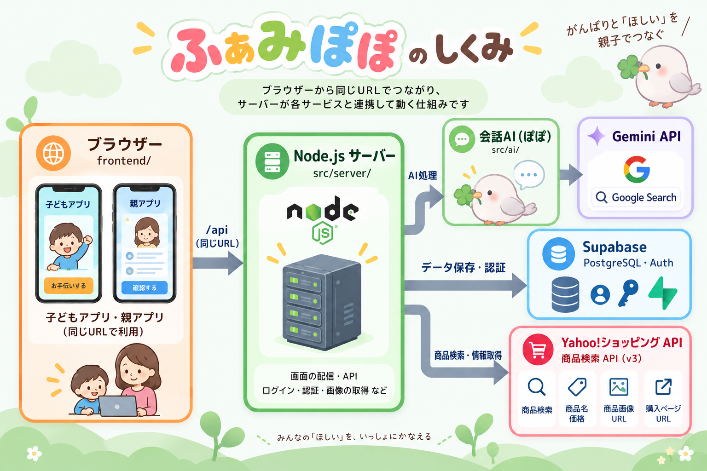

# ふぁみぽぽ

**がんばりと「ほしい」を、親子でつなぐ。**

## 製品概要

ふぁみぽぽは、子どもの「ほしいもの」と、親の「子どもに頑張ってほしいこと」を、AIのぽぽが間に入ってつなぐアプリです。

子どもにはほしいものや興味があり、親には予算や子どもの成長に対する思いがあります。ふぁみぽぽでは、ぽぽがそれぞれの希望を整理し、親子がお互いに納得できるごほうびを一緒に考えます。

子どもはぽぽに相談しながら商品を探し、ほしい理由を自分の言葉で親に伝えます。親はその提案を確認し、意見が合わないときはぽぽを交えて話し合うことができます。

親子で決めた商品は子どもの目標となり、お手伝いで「ありがとうポイント」を貯めて購入を目指します。

子どもにとっては、自分のほしいもののために頑張れる。親にとっては、子どもの自主的な行動や成長を応援できる。そんな、親子双方にとってうれしい仕組みを目指しました。

### ふぁみぽぽを体験する

**[ふぁみぽぽを開く](https://ng-2624.onrender.com/)**

ぜひ、**PCとスマートフォンの2台**を使って体験してみてください。

PCでは保護者として、スマートフォンでは子どもとして操作することで、AIのぽぽが親子それぞれの希望を聞き、双方の間に入って話し合いを支える様子を体験できます。

### 背景(製品開発のきっかけ、課題等）

子どもは自分の好きなものやほしいものを大切にしています。一方、親は子どもにいろいろなことを経験してほしい、勉強やお手伝いにも進んで取り組んでほしいと考えています。

しかし、親がよかれと思って勧めるものに子どもが興味を示さなかったり、子どもがほしがるものに親が価値を見いだせなかったりと、双方の希望がすれ違うことがあります。

また、お手伝いを頼まれたからするだけでは、子どもが自分から取り組む意欲につながりにくいという課題もあります。

そこで考えたのが、**親子それぞれの希望をすり合わせ、子ども自身の目標と日々の頑張りを結びつける仕組み**です。

ふぁみぽぽでは、AIのぽぽが親子の間に入り、お互いの希望や考えを整理します。そして、親子で納得して決めたごほうびに向けて、子どもが自分から行動できる環境をつくります。

親が一方的に与えるごほうびでも、子どもがただ欲しがるだけのごほうびでもなく、親子が一緒に考え、子ども自身の頑張りで手に入れる体験を大切にしています。

### 製品説明（具体的な製品の説明）

1. **親子をつなぐ**：保護者がGoogleでログインして子どもを登録し、招待QR（または招待コード）を出します。子どもの端末で読み取り、親子の画面に出る6桁の確認番号を親が照合して承認すると、接続が完了します。
2. **お手伝いでポイントをためる**：親がお手伝いを頼むか、子どもがやりたいお手伝いを提案します。子どもが「できた」と報告し、親が承認すると、親の定めた量のありがとうポイント（1ポイント＝1円）が入ります。
3. **ぽぽに相談する**：子どもは、ほしいものやその理由を、ぽぽと二人だけで相談します（個別相談）。ぽぽは実際の商品を検索して、候補を出します。
4. **提案を送る**：商品を選ぶと、子どもが「ほしい理由」をまとめます。子どもが内容を確認すると、商品と理由を親に送れます。
5. **親が返事をする**：親は「OK／まだOKできない・相談する」で答えます。相談には理由が必要です。そこで初めて親子とぽぽの共通チャットが開き、親が「購入をOKする／今回は見送る」で相談を終えます。
6. **目標になる**：賛成すると、その商品が目標になり、ホームに目標までのポイント数と期限が出ます。目標ポイントを達成すると、親が商品を買い、「購入済み」にしてやりとりを終えます。

### 特長

#### 1. 「買って！」「ダメ！」で終わらせない、親子の新しいコミュニケーション

ふぁみぽぽでは、AIのぽぽが親子の間に入り、子どもの「ほしい」を親子で話し合うきっかけに変えます。

子どもは自分の思いを親に伝え、親は購入してよいかを理由とともに返事します。意見が合わないときも、ぽぽを交えてお互いの考えを整理しながら相談できます。

一方的にお願いしたり断ったりするのではなく、親子がお互いの気持ちを理解し、納得できる答えを探せることが、ふぁみぽぽの大きな特長です。

#### 2. 子どもの「ほしい」を、自分で考え、自分で伝える力に

子どもがほしいものをうまく説明できなくても、ぽぽとの会話を通じて、何がほしいのか、なぜほしいのかを整理できます。

実際の商品を探して比較し、最後は子ども自身の言葉で理由を書いて親に提案します。ぽぽは子どもの代わりに答えを決めるのではなく、子どもが自分で考えるための手助けをします。

また、ぽぽとの個別相談は本人だけが見ることができるため、親には直接言いづらいことも安心して相談できます。

自分の希望を考え、言葉にし、相手に伝える。 ふぁみぽぽは、買い物を通じて子どもの主体性を育てます。

#### 3. お手伝いを、ほしいものに近づく「ありがとう」に

親子で購入を決めた商品は、子どもの目標になります。

子どもは親から頼まれたお手伝いだけでなく、自分からやりたいお手伝いを提案することもできます。がんばりが認められると「ありがとうポイント」がたまり、目標までの道のりが少しずつ縮まっていきます。

自分の行動が家族の役に立ち、その積み重ねがほしいものにつながる。お手伝いを単なるごほうびのための作業ではなく、家族への貢献と自分の目標を結びつける体験にしています。

### 解決できること

- **子どもの思いが、親に届かない問題**：子どもは、ほしい理由をうまく言葉にできないことがあります。ぽぽが考えを整理する手助けをすることで、子ども自身が自分の希望を理由とともに伝えられるようにします。
- **親だけが決め、子どもが従う一方通行の関係**：購入の判断を親だけで完結させず、子どもの意見にも耳を傾ける機会をつくります。親も判断の理由を伝え、お互いが納得できる結論を目指します。
- **意見の対立が、親子げんかにつながる問題**：親子では感情的になりやすい話し合いにも、第三者としてAIのぽぽが加わります。双方の考えを整理し、意見が違っても落ち着いて話し合えるようにします。
- **お手伝いが、ただ言われたことをするだけになってしまう問題**：子どもが自分からお手伝いを提案でき、家族に認められたがんばりが目標につながります。家族の役に立つ喜びと、自分の力で目標に近づく達成感を育てます。

### 今後の展望

- **Amazonとの連携による収益化**：Amazonのアフィリエイトプログラムと商品情報APIを活用し、保護者がアプリを通じて商品を購入した際に紹介料を得られる仕組みを導入します。利用者が無料で使い続けられるサービスを目指します。
- **お手伝い以外の活動にも対応**：勉強や読書、運動など、子どものさまざまな取り組みにポイントを付与できるようにします。家庭ごとの教育方針や子どもの目標に合わせて、幅広い活動を応援できる仕組みに発展させます。
- **継続的な課題への対応**：単発のお手伝いだけでなく、「毎日30分勉強する」「1週間運動を続ける」など、継続を必要とする課題も設定できるようにします。達成状況を記録し、続けた日数や積み重ねた努力を評価することで、子どもの習慣づくりを支援します。
- **PC向けUIの充実**：現在は子どものスマートフォンでの利用を中心に画面を設計していますが、今後は保護者のPC利用も想定したUIを充実させます。広い画面を活かして、お手伝いの管理や子どもの目標・達成状況をより確認しやすくし、親子それぞれに適した操作環境を目指します。

### 注力したこと（こだわり等）

- **子どもの主体性を尊重するAIの設計**：ぽぽが子どもの代わりに考えたり、親の代わりに判断したりするのではなく、双方の気持ちを引き出し、話し合いを支える役割に徹するよう設計しました。子ども自身が理由を書き、親が最終的な購入判断を行うことで、AIに任せきりにならない仕組みを実現しました。

- **親子双方が使いやすい体験の実現**：子どもには直感的で分かりやすい画面、保護者には必要な情報を確認しやすい画面を用意しました。端末の接続からAIへの相談、商品の提案、お手伝いによる目標達成までを一つのアプリで完結させ、親子が日常的に使えることを重視しました。

- **親子それぞれの本音を守る情報の分離**：子どもと保護者が安心して相談できるよう、個別相談と親子の共有交渉を明確に分離しました。会話履歴を分けるだけでなく、AIに渡す情報もサーバー側で制御し、本人が共有した内容だけを交渉に利用します。相手に見せる情報と見せない情報を仕組みとして分けることで、親子双方のプライバシーを守ることにこだわりました。

- **子どもが安心して利用できるセキュリティ設計**：保護者のGoogle認証に加え、子どもの端末接続にはQRコードと6桁の確認番号による二段階の確認を採用しました。招待コードの有効期限や保護者による承認、接続済み端末の管理・解除にも対応しています。さらに、セッションの安全な管理や不正なリクエストへの対策など、子どもが利用するサービスとして多層的な安全対策を施しました。

## 全体の構成

ふぁみぽぽは、子どもも保護者も同じURLから利用できるWebアプリです。画面の裏側ではNode.jsサーバーが動いており、ログインやデータの保存、AIとの通信をまとめて管理しています。

子どもがぽぽに相談すると、サーバーからGemini APIを呼び出して会話を生成します。商品を探すときは、AIが子どもの希望に合った検索キーワードを考え、Yahoo!ショッピングの商品検索APIから商品名・価格・画像・購入ページのURLを取得します。

親子のプロフィールやお手伝いの記録、ポイント、相談内容などはSupabaseで管理しています。AIはデータベースを直接操作せず、サーバーから渡された情報をもとに返答を生成します。

ブラウザーからの通信は同じURLのサーバーに集約し、GeminiやSupabaseの認証情報を画面に渡さない構成にしています。

### フォルダ構成

| フォルダ・ファイル | 内容 | 詳しい説明 |
|---|---|---|
| [frontend/](frontend/) | 親子が利用する画面。HTML・CSS・JavaScriptで構成 | [画面設計](docs/frontend-design.md) |
| [src/server/](src/server/) | ログイン、権限管理、データ保存、外部APIとの通信を担当するバックエンド | [SETUP.md](SETUP.md) |
| [src/ai/](src/ai/) | ぽぽの会話、商品検索、提案の下書き、親子の交渉を担当 | [AIモジュール](src/ai/README.md) |
| [supabase/migrations/](supabase/migrations/) | DBのテーブル、アクセス権限、ポイントや提案の処理 | [SETUP.md](SETUP.md) |
| [src/shared/](src/shared/) | AIとサーバーの間で共有するデータの型 | [types.ts](src/shared/types.ts) |
| [demo/](demo/) | Googleログイン・Supabaseなしで試せるローカルデモ | [README.md](demo/README.md) |
| [docs/](docs/) | 画面の設計資料 | [frontend-design.md](docs/frontend-design.md) |

### 担当ごとの工夫

#### フロントエンド

**子どもが迷わず使えて、親も安心して操作できる画面を目指しました。**

- **親子それぞれに合わせたUI設計**：同じWebアプリでも、ログインしている人が親か子どもかによって表示を切り替えています。子どもにはひらがなを中心としたやさしい言葉を使い、親には必要な情報や操作を分かりやすく示すことで、幅広い年齢の人が利用しやすい画面にしました。
- **相談内容の公開範囲を分かりやすく表示**：AIとの個別相談と親子の共通チャットでは、誰にメッセージが見えるのかを画面上で明示しています。子どもが安心して本音を話せることと、親子で話し合うときに必要な情報を共有できることの両立を意識しました。
- **通信エラーや二重送信への対策**：画面の読み込みに失敗したときは、自動で最大2回再試行します。一方、ポイントや提案などの保存操作は勝手に再送せず、同じ処理が重複して実行されないようにしています。また、提案の更新時には画面で確認した版番号を送ることで、古い情報による上書きを防いでいます。
- **安全な情報表示**：AIの返答や商品名など、外部から取得した文字列もエスケープしてから画面に表示しています。HTMLとして不正なコードが実行されることを防ぎながら、会話や商品情報を安心して表示できるようにしました。

#### バックエンド

**家族の情報とポイントを正しく管理し、安心して使い続けられる仕組みにこだわりました。**

- **Google認証と安全なセッション管理**：保護者のログインにはGoogle認証とPKCEを利用しています。Supabaseの認証トークンをブラウザーに渡さず、アプリ独自のセッションをHttpOnly Cookieで管理することで、認証情報を安全に扱える構成にしました。
- **QRコードと確認番号による親子接続**：招待QRを読み取るだけで子どもの端末を接続できるようにしながら、6桁の確認番号を親が照合して承認する仕組みを設けました。招待リンクを知っているだけでは接続が完了しないようにし、意図しない端末との接続を防いでいます。
- **DBトランザクションによるポイントの整合性管理**：お手伝いの承認によるポイント加算や、商品の購入によるポイント減算は、DBの関数で一体的に処理しています。通信の重複や複数端末からの操作があっても、同じポイントが二重に加算・減算されないようにしています。
- **提案の版管理とAI処理の排他制御**：親子が同じ提案を操作するときに情報が食い違わないよう、提案の版番号を確認しています。また、AI処理にもDB側のロックを使い、同じ会話に対する処理が重複して進まないようにしました。
- **商品情報の取得と安全な外部通信**：Yahoo!ショッピングの商品検索APIから商品名・価格・画像・購入ページのURLを取得しています。画像の取得では接続先や通信時間、データサイズを制限し、安全性に配慮しています。また、Origin・CSRFトークンの検証、Content-Security-Policy、リクエスト回数の制限を組み合わせ、外部との通信やユーザー操作を安全に扱うようにしています。

#### AI

**AIが何でも決めてしまうのではなく、子どもの気持ちを引き出し、親子の話し合いを支える存在になるよう工夫しました。**

- **子どもに寄り添う会話設計**：Geminiに専用の指示を与え、子どもには短くやさしい言葉で、保護者には丁寧な言葉で応答するようにしています。質問を一度に重ねすぎず、子ども自身が「何がほしいのか」「なぜほしいのか」を少しずつ整理できる会話を目指しました。
- **個別相談と共有交渉の情報分離**：AIに渡す情報を、個別相談と親子の交渉で明確に分けています。個別相談では本人の発言や履歴を参照しますが、共通チャットでは非公開の相談履歴やプロフィールを渡しません。単にAIへ秘密を守るよう指示するのではなく、プログラム側で入力する情報を制御している点が大きな工夫です。
- **AIと商品検索APIを組み合わせた提案機能**：Geminiが会話から子どもの希望や用途を整理して検索キーワードを生成し、Yahoo!ショッピングの商品検索APIから実際の商品情報を取得します。取得した商品名・価格・画像をもとに、希望に近い商品を最大3件紹介します。商品情報とAIによる会話生成を分けることで、実際に購入できる商品を根拠のある情報とともに提示できるようにしました。
- **AIの判断と実際の操作を分離**：ぽぽは提案文の下書きや相談の支援を行いますが、提案の送信、親の承認、ポイントの加算、目標の登録を勝手に実行することはありません。これらの操作はバックエンドが管理し、本人が確認した内容だけが相手に届くようにしています。
- **会話データの取り扱い**：Geminiへのリクエストには毎回 `store: false` を指定し、API上に会話履歴を保持しない設定を利用しています。会話履歴はアプリ側で管理し、必要な範囲だけをAIに渡す構成にしています。

## 開発技術

### 活用した技術

#### API・データ

- Gemini API（AIによる会話・希望の整理・提案文の生成）
- Yahoo!ショッピング 商品検索API（v3）（商品名・価格・画像・購入ページURLの取得）
- Supabase（PostgreSQLによるデータ管理・Authによる認証）
- Googleログイン（OAuth 2.0・PKCE）

#### フレームワーク・ライブラリ・モジュール

- Node.js 24・TypeScript（標準の `http` モジュールによるWebサーバー）
- `@google/genai`（Gemini APIとの連携）
- `qrcode`（招待QRコードの生成）
- PGlite（ローカルデモ・テスト用のデータベース）
- Supabase CLI（データベースのマイグレーション管理）
- HTML・CSS・JavaScript（フレームワークを使わないフロントエンド）

#### デバイス

- スマートフォン・PCのブラウザー

### 独自技術

#### ハッカソンで開発した独自機能・技術

- **親子の提案・交渉システム**：子どもの個別相談から提案の送信、親の回答、共有交渉、目標登録までを段階的に管理する仕組みを開発しました。提案の版管理とDBトランザクションにより、複数の操作が重なっても状態が食い違わないようにしています。  
  [実装：サーバー](src/server/app.ts) / [DB](supabase/migrations/20261025010000_chat_phases.sql)

- **情報の公開範囲を守る会話AI**：個別相談と共有交渉でAIに渡す情報を切り替え、親子それぞれの非公開情報が意図せず共有されないようにしました。AIへの指示だけでなく、サーバーから渡すデータそのものを制御しています。  
  [実装：会話処理](src/ai/conversation.ts) / [プロンプト](src/ai/prompt.ts)

- **QRコードと確認番号による親子接続**：子どもが簡単に参加できるようにしながら、親による確認と承認を必須にした端末接続機能を開発しました。  
  [実装：サーバー](src/server/app.ts) / [DB](supabase/migrations/20261024031810_invitation_security.sql)

- **AIと商品検索APIを連携させた商品提案機能**：子どもの希望をAIで整理し、Yahoo!ショッピングの商品検索APIによって実際の商品を探す仕組みを開発しました。商品名・価格・画像を取得し、子どもが比較しながら選べる候補として提示しています。  
  [実装：商品検索](src/ai/search.ts) / [商品情報の取得](src/server/preview.ts)

- **親子に合わせたUIと通信制御**：同じアプリで親子の画面を切り替え、子ども向けの分かりやすさと保護者向けの操作性を両立しました。通信エラーへの再試行や二重送信の防止にも対応しています。  
  [実装：画面](frontend/app.js) / [通信](frontend/api.js)
